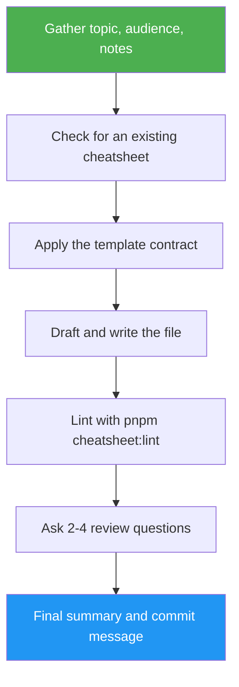

<!--
  DO NOT READ THIS FILE — This README.md is for human catalog browsing only.
  It ships inside the .skill package but is NEVER auto-loaded into agent context.
  The runtime loader only reads SKILL.md + references/ + scripts/ + agents/ when the skill triggers.
  If you're an AI agent, read the SKILL.md file instead for skill instructions.
-->

# Cheatsheet Scribe

> Author an awesome-cheatsheets entry from a topic and your notes, validated against the locked template, with a ready-to-copy commit message.

## Highlights

- Drafts only from your notes, docs you provide, and your answers — never invents commands, flags, or URLs.
- Checks for an existing cheatsheet and asks before overwriting it.
- Follows the locked 7-section template and validates with `pnpm cheatsheet:lint`.
- Asks 2–4 content-specific review questions before finalizing.
- Ends with a status, evidence, and uncertainty summary plus a conventional commit message and PR title — it never commits for you.

## When to Use

| Say this... | Skill will... |
| ----------- | ------------- |
| "/cheatsheet-scribe" | Ask for topic, audience, and draft notes, then author the cheatsheet. |
| "Create a cheatsheet for Ollama — here are my notes" | Draft from the notes, write `src/content/cheatsheets/<slug>/<slug>.md`, and lint it. |
| "Write a cheatsheet about the MCP filesystem server" | Ask for missing facts instead of guessing, then validate the draft. |
| "Rewrite the hermes-agent cheatsheet" | Ask for an explicit `yes, overwrite` before replacing the existing file. |

## How It Works



## Usage

```text
/cheatsheet-scribe
```

## Resources

| Path | Description |
| ---- | ----------- |
| `template-contract.md` | Structural rules every cheatsheet must obey. |
| `references/authoring-rules.md` | Step template, command formatting, alerts, drafting conflicts. |
| `references/review-questions.md` | How to write the 2–4 review questions. |
| `references/handoff.md` | Commit message, PR title, and PR description templates. |
| `references/evaluation.md` | Understanding checks for grading a run. |
| `examples/` | Hermes Agent input/output pair (canonical reference). |
| `evals/evals.json` | Test prompts for skill behavior. |

## Output

One cheatsheet at `src/content/cheatsheets/<slug>/<slug>.md` that passes `pnpm cheatsheet:lint`, plus a final summary with the suggested commit message and PR title. Nothing is staged, committed, or pushed.
