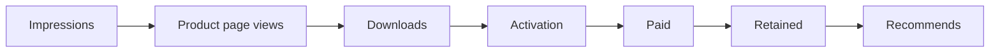

# App Store Marketing 101 — Selling Apple Apps Cheatsheet

**One-line:** To sell an Apple app, find the leakiest stage of your funnel and fix it first: get found (ASO), turn product-page views into downloads, monetize honestly, earn ratings, and bring in traffic from outside the store. Several of Apple's in-store marketing tools are documented for iPhone and iPad only, so (**rule of thumb**) Mac apps lean hardest on that outside traffic.

> [!NOTE]
> **How to read this sheet.** Limits, guideline numbers and platform availability come from Apple's own pages, linked in [Reference](#reference). Anything tagged **Rule of thumb** is practitioner advice, not Apple data. Treat those as starting points to test, not as benchmarks. The running example, **Acme Focus**, is a fictional focus timer that blocks distractions, for Mac and iPhone.

## Prerequisites

- [ ] An Apple Developer Program account with your app record created in App Store Connect.
- [ ] Role: Account Holder, Admin, App Manager or Marketing. This is required for Product Page Optimization tests and Featuring Nominations.
- [ ] Optional, for the agent workflow: an AI coding agent such as Claude Code, Node.js for `asm`, and an App Store Connect API key (`.p8`) for `asc`.
- [ ] A one-sentence positioning statement. If you don't have one yet, Step 2 helps you write it.

## Installation

Marketing is mostly decisions, not software, but an agent can do the repetitive parts: auditing keywords, drafting metadata, generating screenshots, checking guidelines and replying to reviews. You need two free tools.

**1. Agent skills.** Install Luong's four App Store skills with [`asm`](https://github.com/luongnv89/agent-skill-manager), one skill per command:

```bash
npm install -g agent-skill-manager
```

```bash
asm install github:luongnv89/skills --path skills/aso-marketing -p claude --yes
```

```bash
asm install github:luongnv89/skills --path skills/appstore-assets -p claude --yes
```

```bash
asm install github:luongnv89/skills --path skills/appstore-review-checker -p claude --yes
```

```bash
asm install github:luongnv89/skills --path skills/product-launch -p claude --yes
```

| Skill | What it does (from its own description) |
|---|---|
| `aso-marketing` | A 7-phase ASO workflow for keyword strategy, metadata and localization. It waits for you to approve the plan. |
| `appstore-assets` | Generates App Store screenshots, header and search images, and looping videos for iPhone, iPad and Mac from your code or landing page. It does not make App Previews. |
| `appstore-review-checker` | Audits iOS and macOS apps against the App Review Guidelines before you submit, with evidence and fixes. |
| `product-launch` | Picks launch sites (Product Hunt, Hacker News, Reddit, directories) and writes the posts and pitches. It never posts anything itself. |

**2. `asc`, the App Store Connect CLI.** [`asc`](https://github.com/rorkai/App-Store-Connect-CLI) is an independent, MIT-licensed CLI for the App Store Connect API. It is not made or endorsed by Apple.

```bash
brew install asc
```

If you don't use Homebrew, use the install script for macOS and Linux instead:

```bash
curl -fsSL https://asccli.sh/install | bash
```

First-run flow:

1. Create an App Store Connect API key at `https://appstoreconnect.apple.com/access/integrations/api`.
2. Log in with the key:
   ```bash
   asc auth login --name "<PROFILE_NAME>" --key-id "<KEY_ID>" --issuer-id "<ISSUER_ID>" --private-key <PATH_TO_AUTHKEY_P8>
   ```
3. Validate the login:
   ```bash
   asc auth status --validate
   ```
4. List your apps to find `<APP_ID>`:
   ```bash
   asc apps list --output table
   ```

> [!TIP]
> `asc --help` and `asc <command> --help` are the authoritative flag reference. The CLI moves fast, so check there before you script anything.

`asc` also ships its own agent skills for builds, TestFlight, metadata sync, submissions and signing; install them with `asc install-skills`.

## Step-by-Step Setup & Optimization

### Step 1 — Measure the funnel and find the leak

**Goal:** Know which stage loses the most people · **Time:** ~30 min · **Level:** beginner



| Stage | Where you measure it |
|---|---|
| Impressions, product page views, downloads, conversion rate, source | **App Store Connect Analytics → Acquisition → Sources**, split by source type (App Store search, App Store browse, App referrer, Web referrer, and others) |
| Paid conversion, proceeds, subscriptions | **App Store Connect Analytics.** Since March 2026 it includes monetization and subscription metrics, plus a download-to-paid conversion benchmark against peers |
| Activation (the first "aha"), D1/D7/D30 retention, sharing | **In your app.** Analytics has usage metrics and an app-retention view, but only your own events show *why* users stay |

1. Open App Store Connect Analytics, then **Acquisition → Sources**, and note unique impressions, unique product page views, total downloads and conversion rate for the last 30 days.
2. Segment by source type to see whether people find you through search, browsing, other apps or the web.
3. Write the number for each stage in a table and pick **one** stage to fix: the one with the biggest drop.

> [!IMPORTANT]
> Apple's **Conversion Rate** is total downloads and pre-orders divided by **unique device impressions**, not by product page views. To get product-page conversion, divide downloads by unique product page views yourself.

> [!NOTE]
> **Rule of thumb:** around 3–5% product-page conversion (downloads ÷ unique product page views, computed yourself) is fine. Below about 2%, fix the page before you spend anything on traffic. This is a practitioner benchmark, not an Apple figure, and it varies a lot by category and price.

**Verify:** You can name the leakiest stage and the number from App Store Connect Analytics → Acquisition → Sources behind it.

### Step 2 — Write your positioning sentence

**Goal:** One sentence you reuse everywhere · **Time:** ~20 min · **Level:** beginner

1. Fill in the template:
   ```text
   For <WHO>, <APP_NAME> <FIXES_WHAT> — unlike <ALTERNATIVE>, it <WHY_YOU>.
   ```
2. Write the example version for Acme Focus:
   ```text
   For remote developers, Acme Focus blocks distractions on Mac and iPhone together — unlike browser blockers, it works across every app.
   ```
3. Reuse that sentence for the subtitle, the first screenshot caption, the website hero, the launch post and the press kit.

**Verify:** The same sentence, or a 30-character cut of it, appears in your subtitle draft and your first screenshot caption.

### Step 3 — Get found: App Store Optimization (ASO)

**Goal:** Metadata that puts keywords in every field that counts · **Time:** ~1 h · **Level:** intermediate

Apple says search ranking uses **text relevance** (your app name, subtitle, keywords and primary category) and **user behavior** (downloads, ratings and reviews, and more).

| Field | Limit | Notes |
|---|---|---|
| App name | 2–30 characters | Carries your strongest keyword next to your brand. |
| Subtitle | 30 characters | Use a keyword-bearing benefit, not a slogan. |
| Keywords | 100 bytes, comma-separated, no spaces after commas. App Store Connect counts bytes; Apple's search page says "100 characters". Our inference: non-Latin scripts use more than one byte per character | Don't repeat words already in the name, subtitle or category, or plurals of them. Leave out "app", filler words and competitor names. |
| Promotional text | 170 characters | **Doesn't affect search ranking**, so don't put keywords here. |
| Description | 4,000 characters | Write it for people. Apple doesn't list it among its search ranking inputs. Google Play does use descriptions in search. |
| Promoted in-app purchases | Up to 20 on the product page | Promoted in-app purchases can show up in search results. Consumables never do. |

1. Pull the live metadata into files. Acme Focus ships on two platforms, so pass `--platform`. After step 6, repeat steps 1 and 3–6 for the Mac version with `--platform MAC_OS --dir "./metadata-mac"`, and apply the approved keyword plan from step 2 to the files in `./metadata-mac`. Keep the two folders apart: `pull` refuses to overwrite files that already exist.
   ```bash
   asc metadata pull --app "<APP_ID>" --version "<VERSION>" --platform IOS --dir "./metadata"
   ```
2. Ask the agent for a keyword plan (it waits for your approval before writing):
   ```text
   /aso-marketing Plan keywords and metadata for Acme Focus on the US App Store using ./metadata. Positioning: <POSITIONING_SENTENCE>
   ```
3. Validate the edited files locally (lengths and limits):
   ```bash
   asc metadata validate --dir "./metadata"
   ```
4. Preview the upload:
   ```bash
   asc metadata push --app "<APP_ID>" --version "<VERSION>" --platform IOS --dir "./metadata" --dry-run
   ```
5. Push the metadata:
   ```bash
   asc metadata push --app "<APP_ID>" --version "<VERSION>" --platform IOS --dir "./metadata"
   ```
6. Audit the pushed keywords before you submit. `keywords audit` reads App Store Connect, not `./metadata`, so it only sees your plan after the push. Put competitor trademarks in a blocklist, one per line; the audit reports duplicates, overlap with the name and subtitle, the byte budget and blocked terms. If it flags anything, fix the files and repeat steps 3–6.
   ```bash
   asc metadata keywords audit --app "<APP_ID>" --version "<VERSION>" --platform IOS --blocked-terms-file "./blocked-terms.txt"
   ```

> [!WARNING]
> Guideline **2.3.7**: don't pack metadata with trademarked terms, popular app names, pricing or irrelevant phrases, and keep subtitles from referencing other apps. Apple may change keywords it finds inappropriate.

> [!TIP]
> Each localization has its own keywords field, so localizing lets you target each language's own search terms. Long, specific phrases ("focus timer for coding") usually beat broad ones ("productivity") for a new app. **That second point is a rule of thumb.** Practitioners also report that some storefronts index more than one locale, for example US English plus Spanish (Mexico). Apple doesn't document this, so test it before you rely on it.

**Verify:** for each platform, `asc metadata keywords audit` on the pushed version reports no duplicates, no name or subtitle overlap and no blocked terms, and stays within the byte budget.

### Step 4 — Convert on the product page

**Goal:** A page where icon, first screenshots and rating sell the app · **Time:** ~2 h · **Level:** intermediate

**Rule of thumb:** most visitors see only the icon, the first screenshots and the rating before they decide, so treat **screenshots as ads**: one benefit per screenshot, with a short caption.

1. Generate a screenshot set from your app or landing page, one benefit per frame, and tell the agent where to save each set. Use one folder per platform and device size: `asc screenshots upload --locale` reads only the files directly inside `--path` and checks every one against `--device-type`, so a mixed folder fails. The sizes below are the ones Apple requires: the large iPhone size (6.9", or 6.5" if you don't provide 6.9"), the 13" iPad size if the app runs on iPad, and a 16:10 Mac size.
   ```text
   /appstore-assets Create iPhone, iPad and Mac screenshots for Acme Focus, one benefit per frame with a caption; first frame uses: <POSITIONING_SENTENCE>. Save 6.9" iPhone frames (1320 × 2868) to ./screenshots/ios/framed/iphone, 13" iPad frames (2064 × 2752) to ./screenshots/ios/framed/ipad and Mac frames (2880 × 1800) to ./screenshots/mac/framed.
   ```
2. Preview the iPhone upload. The dry run checks every file's size against the device type and shows what would be uploaded, without changing anything:
   ```bash
   asc screenshots upload --app "<APP_ID>" --version "<VERSION>" --platform IOS --locale "en-US" --device-type APP_IPHONE_69 --path ./screenshots/ios/framed/iphone --dry-run
   ```
3. Upload the iPhone set:
   ```bash
   asc screenshots upload --app "<APP_ID>" --version "<VERSION>" --platform IOS --locale "en-US" --device-type APP_IPHONE_69 --path ./screenshots/ios/framed/iphone
   ```
4. Preview, then upload, the iPad set:
   ```bash
   asc screenshots upload --app "<APP_ID>" --version "<VERSION>" --platform IOS --locale "en-US" --device-type APP_IPAD_PRO_3GEN_129 --path ./screenshots/ios/framed/ipad --dry-run
   asc screenshots upload --app "<APP_ID>" --version "<VERSION>" --platform IOS --locale "en-US" --device-type APP_IPAD_PRO_3GEN_129 --path ./screenshots/ios/framed/ipad
   ```
5. Preview, then upload, the Mac set:
   ```bash
   asc screenshots upload --app "<APP_ID>" --version "<VERSION>" --platform MAC_OS --locale "en-US" --device-type APP_DESKTOP --path ./screenshots/mac/framed --dry-run
   asc screenshots upload --app "<APP_ID>" --version "<VERSION>" --platform MAC_OS --locale "en-US" --device-type APP_DESKTOP --path ./screenshots/mac/framed
   ```
6. Repeat steps 2–5 for each other locale, with that locale's `--locale` and folders. To replace a set that already has screenshots, add `--replace --confirm`; preview it first with `--replace --dry-run`.
7. Add a short app preview video (15–30 s, up to three per device size and language).
8. Use promotional text (170 characters) for news such as a sale or a new feature. It changes without a new submission.
9. Check what your platform allows before you plan tests or campaigns:

| Apple tool | iPhone / iPad | Mac App Store |
|---|---|---|
| Screenshots | 1–10 per device size | ✅ Required for Mac apps, 16:10 (for example 2880 × 1800) |
| App previews | Up to 3, 15–30 s | ✅ Landscape only, 1920 × 1080 |
| Promotional text (170 characters, no review) | ✅ iOS 11 or later | ⚠️ Apple's page names only iOS. Check your Mac page in App Store Connect |
| Product Page Optimization: A/B test up to 3 treatments of icon, screenshots and previews for up to 90 days; header creative assets too | ✅ iOS/iPadOS 15 or later; header creative assets on iOS/iPadOS 27 or later | ❌ Apple documents it for iOS and iPadOS only |
| Custom Product Pages: up to 70, each with its own URL; you can assign keywords from your app's approved keyword list to each | ✅ iOS/iPadOS 15 or later | ❌ Apple documents them for iOS and iPadOS only |
| In-App Events: up to 10 published, each up to 31 days | ✅ iOS/iPadOS 15 or later | ❌ Apple says they are "only available on iPhone and iPad apps" |
| Creative assets: product page header and search-result images and video (October 2026) | ✅ iOS/iPadOS 27 or later | ❌ Apple documents them for iOS and iPadOS 27 or later only |
| Promoted in-app purchases in search | ✅ iOS | ⚠️ Apple's page mentions only iOS |

> [!IMPORTANT]
> Apple documents Product Page Optimization, Custom Product Pages and creative assets only for iOS and iPadOS, and its Featuring Nominations help says In-App Events "are only available on iPhone and iPad apps." So plan as if a Mac app can't A/B test its page, run campaign-specific pages, show header creative or publish store events. **Rule of thumb:** that makes the icon, the screenshots and the traffic you bring from outside the store (Step 7) carry more weight on the Mac.

> [!WARNING]
> Guideline **2.3.14**: creative assets "must pertain to your app's content and functionality or overarching brand, follow standard metadata guidelines, and be appropriate for all audiences. They should not include inappropriate content, references to other apps with an intent to mislead, unverifiable product claims, or specific or discounted pricing information."

**Verify:** for each device type, the `asc screenshots upload … --dry-run` lists the files you expect with no size errors, the upload without `--dry-run` completes, and the first frame's caption matches your positioning sentence.

### Step 5 — Monetize without tricks

**Goal:** A pricing flow that converts and passes App Review · **Time:** ~1 h · **Level:** intermediate

1. Pick a model. A free download plus a subscription, with a free tier that shows real value, is the common indie default. **That's a rule of thumb.**
2. Show the paywall at the moment of need, for example when the user reaches a Pro feature, not on first launch. Default the selection to the yearly plan. **Both are rules of thumb.**
3. Keep trials honest. Guideline **3.1.2(a)** allows free trials set up in App Store Connect. **3.1.2(c)** requires you to say clearly what the user gets for the price before they subscribe.
4. Remove any flow that tricks users. Under **3.1.2(a)**, bait-and-switch and tricking users into subscriptions gets apps removed. Under **5.6**, apps must not trick users into unwanted purchases or raise prices in a tricky way. Fake countdowns and fake "only today" offers fall under this. **Applying it to countdowns is our reading of the guideline.**
5. Enroll in the **App Store Small Business Program**. It cuts the commission to **15%** on paid apps and in-app purchases if you and any associated developer accounts earned no more than US$1 million in total proceeds in the previous calendar year, and stay under US$1 million in the current year. You must enroll; it doesn't happen automatically.
6. Run a pre-submission audit:
   ```text
   /appstore-review-checker Audit Acme Focus (macOS + iOS) before submission, focusing on 3.1.2 subscriptions, 2.3 metadata and 5.6.
   ```
7. Run the readiness check:
   ```bash
   asc validate --app "<APP_ID>" --version "<VERSION>"
   ```

**Verify:** `asc validate` and the `/appstore-review-checker` report show no blocking findings on subscriptions or metadata.

### Step 6 — Earn ratings and keep users

**Goal:** More ratings from happy users, and replies to unhappy ones · **Time:** ~1 h · **Level:** intermediate

1. Ask for a rating with the system prompt, `RequestReviewAction` (SwiftUI; iOS and iPadOS 16, Mac Catalyst 16, macOS 13 and visionOS 1 or later). Call it after the user finishes something successfully and, like Apple's sample, at most once per app version:
   ```swift
   @Environment(\.requestReview) private var requestReview
   @AppStorage("completedSessions") private var completedSessions = 0
   @AppStorage("lastVersionPromptedForReview") private var lastVersionPrompted = ""

   func sessionCompleted() {
       completedSessions += 1
       let version = Bundle.main.object(forInfoDictionaryKey: "CFBundleVersion") as? String ?? ""
       if completedSessions >= 5, version != lastVersionPrompted {
           requestReview()
           lastVersionPrompted = version
       }
   }
   ```
2. Follow Apple's rules for the prompt:
   - The system shows it at most **three times in 365 days**.
   - Don't show it at launch.
   - Don't call it from a button tap, because it may not appear.
   - Ask after the user completes a sequence successfully.
   - **Rule of thumb:** never ask right after an error or a crash.
3. Add a persistent "Write a review" link in Settings: your product page URL with `?action=write-review` appended.
4. Read the 1- and 2-star reviews:
   ```bash
   asc reviews list --app "<APP_ID>" --stars 1,2
   ```
5. Reply to the reviews (5.6.1 says to respond respectfully, with no personal information, spam or marketing):
   ```bash
   asc reviews respond --review-id "<REVIEW_ID>" --response "<REPLY_TEXT>"
   ```
6. Watch retention at D1, D7 and D30 in your in-app analytics, and build sharing into the product, for example exportable session summaries. **Rule of thumb:** improving retention usually pays more than buying acquisition.

> [!CAUTION]
> Never pay for or incentivize ratings. The **Section 3 introduction** of the App Review Guidelines forbids manipulating reviews or chart rankings with paid, incentivized, filtered or fake feedback. **3.2.2(x)** forbids forcing users to rate the app to unlock features. **5.6.3 Discovery Fraud** forbids manipulating reviews, charts, search or referrals. **5.6.1** forbids custom review prompts.

**Verify:** `asc reviews list --app "<APP_ID>" --stars 1,2` shows every recent low-star review answered.

### Step 7 — Drive off-store traffic and ask Apple to feature you

**Goal:** Visitors from outside the store, plus a featuring nomination · **Time:** ~2 h · **Level:** beginner

1. Build a website that ranks for the problem you solve: comparison pages ("Acme Focus vs browser blockers"), how-to guides and a press kit with your icon, screenshots, a short description and contact details.
2. Add a Smart App Banner on your website for iPhone and iPad visitors. Apple documents it for Safari on iOS, so on the Mac, link to your Mac App Store page instead:
   ```html
   <meta name="apple-itunes-app" content="app-id=<APP_ID>">
   ```
3. Plan the launch with the agent. It picks free channels and drafts posts, but you do the posting:
   ```text
   /product-launch Plan a free launch for Acme Focus (Mac + iPhone): Product Hunt, Show HN, relevant subreddits, newsletters, YouTube reviewers, directories and bundles.
   ```
4. Give before you promote. Read and follow each community's self-promotion rules (for example Hacker News's Show HN guidelines). Pitch newsletters and YouTube reviewers for editorial coverage, not paid placements.
5. Submit a Featuring Nomination in App Store Connect under **Featuring → Nominations**. Choose New Content, App Enhancements or App Launch, then choose the platforms. Apple's Nominations help asks for at least 3 weeks' notice; Getting featured says 2 weeks and recommends up to three months for wider consideration.
6. Shape the release around what editors look for:
   - user experience;
   - UI design;
   - innovation with new technologies;
   - uniqueness;
   - accessibility;
   - localization;
   - a strong product page.
7. Check what nominations the CLI can manage:
   ```bash
   asc nominations --help
   ```

**Verify:** The nomination shows as submitted under Featuring → Nominations, and the launch plan from `/product-launch` lists at least one dated off-store action.

## Best Practices

### Weekly routine

1. **Monday:** Check the funnel numbers in App Store Connect Analytics against last week.
2. **Pick one change:** Change one thing, such as the subtitle, the first screenshot or the paywall copy, and leave it for 2–4 weeks before judging it. **That's a rule of thumb.** On iPhone and iPad, use Product Page Optimization so you get a controlled test instead.
3. **Reviews:** Reply to new reviews, low-star ones first.
4. **Off-store:** Do one thing outside the store: a post, a pitch, a how-to page or a directory listing.

### Do

- Fix the leakiest funnel stage before touching any other.
- Keep the positioning sentence identical across the store, the website and launch posts.
- Spend all 100 keyword bytes, without repeating words from the name or subtitle.
- Localize the product page. It helps users and gives you more keyword fields.
- Use promotional text for timely news, because it needs no review.
- For Mac apps, put more effort into the website, communities and featuring, since Product Page Optimization, Custom Product Pages, creative assets and In-App Events aren't documented for the Mac App Store.
- Let the agent draft and audit, and keep a human approval step before anything goes live: run `--dry-run` first, approve the ASO plan, and post launch posts yourself.

### Don't

- Buy traffic before the page converts.
- Change several things at once, because then you can't tell what worked.
- Use a vague subtitle ("Your productivity companion") that carries no keyword or benefit.
- Show the paywall on first launch, before the user has seen any value. **Rule of thumb.**
- Ignore reviews. **Rule of thumb:** unanswered 1-star reviews turn away visitors who are deciding.
- Market only inside the store. **Rule of thumb:** that hurts Mac apps most.
- Put competitor names in keywords or subtitles (2.3.7), use custom rating prompts (5.6.1) or incentivize ratings (Section 3 intro; 3.2.2(x)).

## Quick Command Reference

Commands are grouped by goal. `asc` flags are taken from the CLI's README, command docs and `--help`; run `asc <command> --help` to confirm them for your version.

**Setup**

```bash
npm install -g agent-skill-manager
asm install github:luongnv89/skills --path skills/aso-marketing -p claude --yes
brew install asc
asc version
asc auth status --validate
asc apps list --output table
```

**ASO and metadata**

```bash
# iPhone and iPad version
asc metadata pull --app "<APP_ID>" --version "<VERSION>" --platform IOS --dir "./metadata"
asc metadata validate --dir "./metadata"
asc metadata push --app "<APP_ID>" --version "<VERSION>" --platform IOS --dir "./metadata" --dry-run
asc metadata push --app "<APP_ID>" --version "<VERSION>" --platform IOS --dir "./metadata"
asc metadata keywords audit --app "<APP_ID>" --version "<VERSION>" --platform IOS --blocked-terms-file "./blocked-terms.txt"
# Mac version: its own folder; apply the same keyword plan before validating
asc metadata pull --app "<APP_ID>" --version "<VERSION>" --platform MAC_OS --dir "./metadata-mac"
asc metadata validate --dir "./metadata-mac"
asc metadata push --app "<APP_ID>" --version "<VERSION>" --platform MAC_OS --dir "./metadata-mac" --dry-run
asc metadata push --app "<APP_ID>" --version "<VERSION>" --platform MAC_OS --dir "./metadata-mac"
asc metadata keywords audit --app "<APP_ID>" --version "<VERSION>" --platform MAC_OS --blocked-terms-file "./blocked-terms.txt"
asc localizations list --app "<APP_ID>" --type app-info
```

**Product page and media**

```bash
# One folder per device type; run each with --dry-run first, then without it
asc screenshots upload --app "<APP_ID>" --version "<VERSION>" --platform IOS --locale "en-US" --device-type APP_IPHONE_69 --path ./screenshots/ios/framed/iphone --dry-run
asc screenshots upload --app "<APP_ID>" --version "<VERSION>" --platform IOS --locale "en-US" --device-type APP_IPHONE_69 --path ./screenshots/ios/framed/iphone
asc screenshots upload --app "<APP_ID>" --version "<VERSION>" --platform IOS --locale "en-US" --device-type APP_IPAD_PRO_3GEN_129 --path ./screenshots/ios/framed/ipad --dry-run
asc screenshots upload --app "<APP_ID>" --version "<VERSION>" --platform IOS --locale "en-US" --device-type APP_IPAD_PRO_3GEN_129 --path ./screenshots/ios/framed/ipad
asc screenshots upload --app "<APP_ID>" --version "<VERSION>" --platform MAC_OS --locale "en-US" --device-type APP_DESKTOP --path ./screenshots/mac/framed --dry-run
asc screenshots upload --app "<APP_ID>" --version "<VERSION>" --platform MAC_OS --locale "en-US" --device-type APP_DESKTOP --path ./screenshots/mac/framed
asc video-previews list --version-localization "<VERSION_LOCALIZATION_ID>"
asc product-pages --help
asc app-events list --app "<APP_ID>"
```

**Ratings, reviews and release**

```bash
asc reviews ratings --app "<APP_ID>"
asc reviews list --app "<APP_ID>" --stars 1,2
asc reviews respond --review-id "<REVIEW_ID>" --response "<REPLY_TEXT>"
asc validate --app "<APP_ID>" --version "<VERSION>"
asc review status --app "<APP_ID>"
```

**Analytics and featuring**

```bash
asc analytics requests --app "<APP_ID>"
asc nominations --help
```

**Agent prompts (Claude Code)**

```text
/aso-marketing <APP_AND_MARKET_BRIEF>
/appstore-assets <SCREENSHOT_BRIEF>
/appstore-review-checker <AUDIT_SCOPE>
/product-launch <LAUNCH_BRIEF>
```

**In-app and web snippets**

```swift
@Environment(\.requestReview) private var requestReview
```

```html
<meta name="apple-itunes-app" content="app-id=<APP_ID>">
```

## Expected Outcomes

After working through Steps 1–7 you have:

- A funnel table with one named leak and one change in progress, measured in App Store Connect Analytics and your in-app events.
- A single positioning sentence reused in the subtitle, the first screenshot, the website and the launch posts.
- Keywords that use the full 100-byte budget with no duplicates or trademarks, checked by `asc metadata keywords audit` on the pushed iPhone and Mac versions before you submit.
- A product page with benefit-led screenshots, an app preview and current promotional text, plus a clear list of which tests and campaigns your platform supports.
- A monetization flow that passes `/appstore-review-checker` and `asc validate`, and Small Business Program enrollment if you qualify.
- Rating prompts that follow Apple's limits, and replies to every low-star review.
- A free launch plan, a website with a Smart App Banner for iOS visitors, and a Featuring Nomination submitted with enough notice.

## Reference

<details>
<summary>Sources & deeper reading</summary>

**Apple: App Store marketing and search**

- [App Store for developers](https://developer.apple.com/app-store/)
- [App Store search](https://developer.apple.com/app-store/search/) — the ranking inputs (name, subtitle, keywords, primary category, user behavior); keyword-field rules; promotional text doesn't affect ranking
- [App information](https://developer.apple.com/help/app-store-connect/reference/app-information/app-information) — name 2–30 characters, subtitle 30 characters
- [Platform version information](https://developer.apple.com/help/app-store-connect/reference/app-information/platform-version-information) — keywords 100 bytes (localizable), promotional text 170 characters without resubmission, description 4,000 characters, up to 3 app previews
- [Screenshot specifications](https://developer.apple.com/help/app-store-connect/reference/app-information/screenshot-specifications) — up to 10 per device size; Mac 16:10, required
- [App preview specifications](https://developer.apple.com/help/app-store-connect/reference/app-information/app-preview-specifications) — 15–30 s; macOS landscape 1920 × 1080
- [Promoting your In-App Purchases](https://developer.apple.com/app-store/promoting-in-app-purchases/) — up to 20 promoted; can show in search; consumables excluded
- [Product page optimization](https://developer.apple.com/app-store/product-page-optimization/) and the [App Store Connect help overview](https://developer.apple.com/help/app-store-connect/create-product-page-optimization-tests/overview-of-product-page-optimization) — iOS/iPadOS 15 or later, 3 treatments, 90 days
- [Custom product pages](https://developer.apple.com/app-store/custom-product-pages/) and [Configure multiple product page versions](https://developer.apple.com/help/app-store-connect/create-custom-product-pages/configure-multiple-product-page-versions) — up to 70, keywords from your latest approved app version, iOS/iPadOS 15 or later
- [In-App Events](https://developer.apple.com/app-store/in-app-events/) and the [App Store Connect help overview](https://developer.apple.com/help/app-store-connect/offer-in-app-events/overview-of-in-app-events) — iOS/iPadOS 15 or later, 10 published, 31 days
- [Creative assets announcement (October 2026)](https://developer.apple.com/news/?id=ljpl7kyn) and [Creative assets specifications](https://developer.apple.com/help/app-store-connect/reference/app-information/creative-assets-specifications)
- [Manage your App Store assets](https://developer.apple.com/help/app-store-connect/manage-app-information/manage-your-app-store-assets) — creative assets "available for iOS and iPadOS apps and games running iOS 27 or iPadOS 27 or later"
- [App Store asset best practices](https://developer.apple.com/app-store/asset-best-practices/) — creative assets appear in iOS 27 and iPadOS 27 and later; product page optimization can test alternative header visuals
- [App Store Connect Analytics: Acquisition](https://developer.apple.com/help/app-store-connect-analytics/acquisition/acquisition/) — Acquisition → Sources; impressions, page views, downloads, conversion rate, source types, macOS attribution note
- [Metric definitions](https://developer.apple.com/help/app-store-connect-analytics/reference/metrics-definitions) — Conversion Rate is total downloads and pre-orders divided by unique device impressions
- [Analytics update, March 2026](https://developer.apple.com/news/?id=hh6v4b55) — more than 100 new metrics, including monetization and subscription data; download-to-paid conversion benchmark

**Apple: rules, ratings, money and featuring**

- [App Review Guidelines](https://developer.apple.com/app-store/review/guidelines/) — 2.3.7 metadata and trademarks; 2.3.14 creative assets; 3.1.2(a)/(c) subscriptions; 3.2.2(x) forced ratings; Section 3 intro on paid and incentivized reviews; 5.6, 5.6.1, 5.6.3
- [Requesting App Store reviews](https://developer.apple.com/documentation/storekit/requesting-app-store-reviews) — at most 3 prompts in 365 days, timing guidance, `action=write-review`
- [`RequestReviewAction`](https://developer.apple.com/documentation/storekit/requestreviewaction) — iOS and iPadOS 16, Mac Catalyst 16, macOS 13, visionOS 1 or later
- [App Store Small Business Program](https://developer.apple.com/app-store/small-business-program/) — 15% commission, US$1 million threshold, enrollment required
- [Promoting apps with Smart App Banners](https://developer.apple.com/documentation/webkit/promoting-apps-with-smart-app-banners) — Safari on iOS, `apple-itunes-app` meta tag
- [Getting featured on the App Store](https://developer.apple.com/app-store/getting-featured/) — what editors look for, at least 2 weeks' notice, up to 3 months for wider consideration
- [Nominate your app for featuring](https://developer.apple.com/help/app-store-connect/manage-featuring-nominations/nominate-your-app-for-featuring) — Featuring → Nominations, a minimum of 3 weeks, In-App Events only for iPhone and iPad apps
- [Apple newsroom: App Store capabilities, June 2026](https://www.apple.com/newsroom/2026/06/apple-expands-app-store-capabilities-to-help-developers-grow-and-reach-new-users/)

**Other stores and communities**

- [Google Play Console Help: Get discovered on Google Play search](https://support.google.com/googleplay/android-developer/answer/4448378) — Play search considers app descriptions
- [Hacker News: Show HN guidelines](https://news.ycombinator.com/showhn.html)

**Agent tooling**

- [`asc`: App Store Connect CLI](https://github.com/rorkai/App-Store-Connect-CLI) (independent, MIT) and its [command map](https://github.com/rorkai/App-Store-Connect-CLI/blob/main/docs/COMMANDS.md)
- [luongnv89/skills](https://github.com/luongnv89/skills): `aso-marketing`, `appstore-assets`, `appstore-review-checker`, `product-launch`
- [asc agent skills](https://github.com/rorkai/app-store-connect-cli-skills), installed with `asc install-skills`
- [agent-skill-manager (`asm`)](https://github.com/luongnv89/agent-skill-manager)
- [Related: ASM cheatsheet](https://github.com/luongnv89/awesome-cheatsheets/blob/main/src/content/cheatsheets/asm/asm.md)
- [Related: Agent Skills cheatsheet](https://github.com/luongnv89/awesome-cheatsheets/blob/main/src/content/cheatsheets/agent-skills/agent-skills.md)

**Labelled as practitioner advice (not Apple data):** the 3–5% and 2% conversion benchmarks; long-tail beats broad keywords; storefronts indexing extra locales (US + Spanish (Mexico)); screenshots-as-ads; free tier, paywall timing and yearly default; not prompting after errors; retention beats acquisition; unanswered 1-star reviews deter visitors; Mac apps leaning hardest on off-store traffic; and the 2–4 week test window.

</details>
