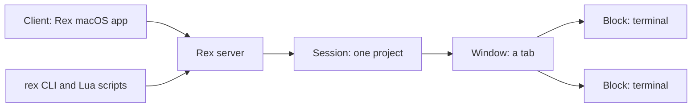

# Superlogical Rex — Terminal Multiplexer Cheatsheet

**One-line:** Rex is the terminal multiplexer from Superlogical, the company co-founded by Ghostty creator Mitchell Hashimoto. It is a native macOS terminal whose sessions live on a Rex server, so you can close the app, reconnect from another device, and pick up where you left off. Every part of it can be scripted through the `rex` CLI, Lua, and a self-documenting server API.

> [!WARNING]
> Rex is in **public beta**, and the beta covers **only the macOS app**. Invites go out in waves to the Superlogical mailing list. Linux and Windows servers and iOS, Linux, and Windows clients exist but aren't part of testing yet. Commands and APIs may change before the stable release, so check `rex help` and `rex api list` on your installed build.

## Prerequisites

- [ ] A Mac. The public beta ships only the macOS app.
- [ ] An invite from the Superlogical mailing list ([sign up on the announcement page](https://www.superlogical.com/updates/public-testing-beginning))
- [ ] A Discord account. Beta testers log in with Discord to download the app.
- [ ] Optional: `jq`, for pulling IDs out of `--json` output in shell scripts
- [ ] Optional: Claude Code, Codex, OpenCode, or Pi, for the built-in agent skill

> [!NOTE]
> Rex is free, and Superlogical says it always will be. The Rex app and server need no account and can be fully self-hosted. The mailing-list signup and Discord login apply only to the beta. The stable release will be a direct download that asks for no contact details.

## Installation

There is no `curl`, Homebrew, or package-manager installer during the beta. The app is the installer.

1. Join the mailing list from the [Superlogical site](https://www.superlogical.com/) and wait for your invite.
2. Open the [Installation page](https://www.superlogical.com/rex/docs/installation), choose **Log in with Discord**, and download **Rex for macOS**.
3. Install and launch the app. The macOS app is self-contained: it starts its own local Rex server, so no setup is needed before you start.
4. Open a terminal in Rex. Every Rex terminal has `rex` on its `PATH` already, with the current session and block preset in its environment. Check the server version:

   ```bash
   rex api call server.version
   ```

5. List the commands:

   ```bash
   rex help
   ```

> [!TIP]
> Press `Cmd+Shift+P` to open the command palette. Every built-in and custom action is listed there, including **Install Rex for Agents**.

Rex needs no configuration file. Add `~/.config/rex/init.lua` only when there is something you want to change (Step 2).

## Step-by-Step Setup & Optimization

### Step 1 — First session and the Rex object model

**Goal:** Know which session, window, and block you are in, and how CLI targets resolve · **Time:** ~10 min · **Level:** beginner

Rex has four kinds of objects. Every CLI command acts on one or more of them:

| Thing | What it is |
|---|---|
| **Session** | A group of related work, such as one project. The server keeps it running whether or not anything is looking at it. |
| **Window** | A tab within a session. It holds a layout of blocks. |
| **Block** | One application in a window. Today that is always a terminal. |
| **Client** | A program connected to the server, such as the macOS app. |



1. List your sessions:

   ```bash
   rex ls
   ```

2. Show the session you are in:

   ```bash
   rex session inspect
   ```

3. Show the terminal you are typing in:

   ```bash
   rex block inspect
   ```

4. Print the context variables Rex sets in every terminal. With no target flags, commands act on this context:

   ```bash
   echo "$REX_SESSION" "$REX_BLOCK" "$REX_SERVER"
   ```

5. To act somewhere else, add a target flag: `-s` (session), `-w` (window), `-b` (block), `-C` (client), or `-S` (server). For example, this types into the second tab of the `build` session:

   ```bash
   rex send -s build -w 2 'make test'
   ```

Rex resolves a target by trying, in order: a full ID (`session:01a1…`), a case-insensitive label (`build`), a 1-based position (`-w 2` is the second tab), and finally the last 4+ characters of an ID. If a target matches more than one thing, the command changes nothing, lists the matches, and exits with status `3`.

**Verify:** `rex ls` lists at least one session, and `rex block inspect` describes the terminal you ran it in.

> [!TIP]
> Labels are handy at a prompt, but they can change, and two things can share one. Scripts should save the IDs that `--json` returns.

### Step 2 — Make the keys your own in `init.lua`

**Goal:** A validated, reloaded `init.lua` with your shortcuts, sequences, and modes · **Time:** ~15 min · **Level:** intermediate

Rex reads `$XDG_CONFIG_HOME/rex/init.lua`, or `~/.config/rex/init.lua` when that variable isn't set. To use a different file, set `REX_CONFIG` in the environment of the **Rex server process**. The server reads the file, not the app. The file is Lua 5.1, and `require("keys")` loads `keys.lua` from the same directory.

1. Create the config directory:

   ```bash
   mkdir -p ~/.config/rex
   ```

2. Add single-key shortcuts to `~/.config/rex/init.lua`. The format is `rex.bind(key, action, args)`:

   ```lua
   rex.bind("cmd+d", "pane.split", { direction = "right" })
   rex.bind("shift+cmd+d", "pane.split", { direction = "down" })
   rex.bind("cmd+e", "pane.zoom")
   ```

3. Optional: add tmux-style prefix sequences. Join the keys with `>`, and press `Escape` to cancel a sequence partway:

   ```lua
   rex.bind("ctrl+b>c", "client.tab.new")
   rex.bind("ctrl+b>n", "client.tab.next")
   rex.bind("ctrl+b>p", "client.tab.previous")
   -- % and " on a US layout
   rex.bind("ctrl+b>shift+5", "pane.split", { direction = "right" })
   rex.bind("ctrl+b>shift+'", "pane.split", { direction = "down" })
   rex.bind("ctrl+b>z", "pane.zoom")
   rex.bind("ctrl+b>x", "pane.close")
   -- Press Ctrl+B twice to send one to the terminal
   rex.bind("ctrl+b>ctrl+b", "pane.send_key", { key = "ctrl+b" })
   ```

4. Optional: add a key mode, where arrow keys resize panes until you press `Escape`. Prefix a key with the mode name and a slash (`resize/left`):

   ```lua
   rex.mode("resize", { exclusive = true })
   rex.bind("cmd+r", "client.mode.enter", { name = "resize" })
   rex.bind("resize/left", "pane.resize", { direction = "left" })
   rex.bind("resize/right", "pane.resize", { direction = "right" })
   rex.bind("resize/up", "pane.resize", { direction = "up" })
   rex.bind("resize/down", "pane.resize", { direction = "down" })
   rex.bind("resize/shift+left", "pane.resize", { direction = "left", amount = 15 })
   rex.bind("resize/=", "pane.balance")
   rex.bind("resize/enter", "client.mode.exit")
   ```

5. Check the file without applying it. Errors are reported as `init.lua:<LINE>`, and the command exits with status `1` on any error:

   ```bash
   rex config check
   ```

6. Apply the file. Rex doesn't watch the file, so reload after every edit:

   ```bash
   rex config reload
   ```

7. See what the running server loaded, with the file and line behind each binding:

   ```bash
   rex keymap
   ```

8. Actions come from the client, so look up their names and arguments on the connected app (`?` marks an optional argument):

   ```bash
   rex client ls
   ```

   ```bash
   rex -C <CLIENT_LABEL> actions
   ```

**Verify:** `rex keymap` lists each new binding with its `init.lua:<LINE>` source, and pressing `Cmd+D` splits the focused pane to the right.

> [!IMPORTANT]
> A key's meaning comes from three places, in rising priority: the client's defaults, then `init.lua`, then shortcuts set in the app (**Change Shortcut…**). If a binding in your file seems to do nothing, check whether the app has its own shortcut for that key.

> [!WARNING]
> A key either runs an action right away or starts a sequence, never both. The newer binding wins: `rex.bind("cmd+k", …)` followed by `rex.bind("cmd+k>s", …)` makes the first binding unreachable. Once `Ctrl+B` starts a sequence, it no longer reaches the terminal, so keep the `ctrl+b>ctrl+b` passthrough.

> [!NOTE]
> `rex config reload` must run on the server's machine. It is refused over a remote connection. If Lua can't parse the file (a syntax error), the server keeps the bindings from the last good load. A misspelled action name isn't an error in `rex config check`; the client reports it as a warning when it loads the keymap.

### Step 3 — Drive Rex from shell scripts

**Goal:** A one-command project layout whose terminals you can type into, read, and wait on · **Time:** ~15 min · **Level:** intermediate

1. Create a session named `api` that runs your editor:

   ```bash
   rex new api --cwd <PROJECT_DIR> -- nvim
   ```

2. Split a labeled shell below the editor, giving it 30% of the space:

   ```bash
   rex split -s api --split=below --ratio 30 --cwd <PROJECT_DIR> --label shell
   ```

3. Add a window that follows the logs, without moving focus:

   ```bash
   rex run -s api --label logs --focus=false -- tail -f <PROJECT_DIR>/app.log
   ```

4. Type a command into the shell. `rex send` doesn't press Enter:

   ```bash
   rex send -s api -b shell 'make test'
   ```

5. Press Enter in that shell:

   ```bash
   rex send-key -s api -b shell enter
   ```

6. Read a terminal's screen. Add `--unwrap` to join wrapped lines, or `--format html` / `--format vt` to keep styling:

   ```bash
   rex capture -s api -b logs --trim
   ```

7. Run a command and exit with its status:

   ```bash
   rex run --wait -- sh -c 'make build && make test'
   ```

8. In scripts, save the ID instead of relying on labels. If the tests fail or time out, zoom the split:

   ```bash
   block=$(rex split --keep-open --focus=false --json -- make test | jq -r '.block_ids[0]')
   rex wait --for 10m "$block" || rex zoom -b "$block" --on
   ```

**Verify:** `rex capture -s api -b logs --trim` prints the latest lines of `app.log`.

Options shared by `rex run` and `rex split`:

| Option | Does |
|---|---|
| `-- COMMAND` | Runs a command instead of an interactive shell |
| `--cwd DIR` | Sets the working directory |
| `--label TEXT` | Labels the new block |
| `--split DIRECTION` | Places the block `right`, `left`, `above`, or `below` its anchor |
| `--ratio PCT` | Gives the new block that percentage of the split |
| `--focus=false` | Leaves focus where it was |
| `--keep-open` | Keeps the terminal open after its command exits |
| `--wait` | Waits for the command and exits with its status |

> [!NOTE]
> Commands run with your login shell's environment, so `PATH` applies but aliases don't. Rex doesn't pass commands through a shell, so use `sh -c '…'` for pipes and `&&`. `rex send-key` uses the same key names as shortcuts, so `rex send-key ctrl+c` interrupts the running program.

### Step 4 — Custom actions, Lua scripts, and event handlers

**Goal:** Your own actions in the palette, plus scripts that build layouts and react to events · **Time:** ~20 min · **Level:** advanced

1. Define a custom action in `init.lua` and bind it. Custom action names use lowercase letters, digits, and underscores, with no dots. Dotted names such as `pane.split` belong to clients:

   ```lua
   rex.action{
     name  = "scratch",
     title = "Open Scratch Window",
     run   = function(ctx, args)
       rex.session.new_window{
         layout = rex.layout.block{
           flavor = "com.superlogical.terminal.shell",
         },
       }
     end,
   }

   rex.bind("shift+cmd+n", "scratch")
   ```

2. Reload so the action shows up in the palette and the CLI:

   ```bash
   rex config reload
   ```

3. Run it from the CLI:

   ```bash
   rex do scratch
   ```

4. While you iterate, run one action straight from the file without reloading the live config:

   ```bash
   rex do ~/.config/rex/init.lua --action scratch
   ```

5. Write a one-shot script, such as `htop.lua`:

   ```lua
   rex.session.new_window{
     layout = rex.layout.block{
       flavor  = "com.superlogical.terminal.shell",
       options = { command = { "htop" } },
     },
   }
   ```

6. Run it:

   ```bash
   rex do htop.lua
   ```

7. Run inline Lua. Whatever the script returns is printed as JSON:

   ```bash
   rex do -e 'return rex.call("session.list")'
   ```

8. Write a long-running handler, such as `label.lua`, which labels every terminal with its directory:

   ```lua
   rex.on("terminal.pwd_changed", function(ctx, ev)
     local dir = ev.pwd:match("([^/]+)/?$")
     rex.session.set_block_label{
       block_id = ctx.block_id,
       label    = dir,
     }
   end)
   ```

9. Run it across every session until you press `Ctrl+C`. Add `--for 10m` to stop after a set time, or `--fail-fast` to exit on the first handler error:

   ```bash
   rex do label.lua --all
   ```

**Verify:** `rex do scratch` opens a new shell window, and `rex actions` lists `scratch`.

Pass script arguments as `key=value` pairs (`n=2` is a number, `on=true` a boolean), or as JSON with `--args '{…}'` or `--args @args.json`. Scripts read them from `rex.args`. Use `rex.wait(event, filter, timeout)` for "start, wait, then act" scripts, and `rex.on` for handlers that should fire every time.

> [!WARNING]
> `rex.on` works only in scripts run with `rex do`. In `init.lua` it is reported as a warning and never called. Event names aren't checked, so a typo registers a handler that never fires.

> [!IMPORTANT]
> App actions such as `rex do pane.split direction=right`, and `rex.client.queue(...)` inside an action, ask the macOS app to act. The app accepts them only when **Remote Control** is turned on in its settings.

> [!CAUTION]
> Scripts run locally with Lua's full standard library, including `io` and `os`. Treat a `.lua` script like a shell script, and read it before you run it.

### Step 5 — Let coding agents drive Rex

**Goal:** An agent that opens panes, runs tests beside itself, and reads terminal screens · **Time:** ~10 min · **Level:** intermediate

1. Preview what setup would change:

   ```bash
   rex skill setup --dry-run
   ```

2. Install the skill and session hook for every agent Rex finds. It is safe to re-run after you install new agents. On macOS you can instead run **Install Rex for Agents** from the palette (`Cmd+Shift+P`):

   ```bash
   rex skill setup
   ```

3. Optional: set up only the current repository instead of your account:

   ```bash
   rex skill setup --project
   ```

4. Approve the hook. In **Codex**, run `/hooks` and approve Rex's hook. **Claude Code** runs no hooks until you trust the folder it starts in.
5. Check the install state for each agent:

   ```bash
   rex skill status
   ```

6. Start a **new** agent session inside a Rex terminal, then ask things like *"Run the tests beside you and fix whatever fails"* or *"Start the dev server in another tab and tell me when it's ready."*
7. For agents without built-in support, have the agent run this command and follow the guide it prints:

   ```bash
   rex skill show
   ```

8. Optional, for Rex Beta Discord members: add the community MCP server. It searches the Rex docs and past beta discussions:

   ```bash
   claude mcp add -s user --transport http superlogical https://www.superlogical.com/rex/community-mcp
   ```

**Verify:** `rex skill status` shows `current` for the skill, and for the hook where the agent supports one.

| Agent | `--agent` | Skill | Hook |
|---|---|---|---|
| Claude Code | `claude` | `~/.claude/skills/rex` | `~/.claude/settings.json` |
| Codex | `codex` | `~/.agents/skills/rex` | `~/.codex/hooks.json` |
| OpenCode | `opencode` | `~/.agents/skills/rex` | Not supported |
| Pi | `pi` | `~/.agents/skills/rex` | Not supported |

The hook tells the agent at session start that it runs in Rex and which session and terminal it is in. It also has the agent name the session after its task (for example `fix-login-redirect`).

Report status from your own long-running scripts with the **Program Status Protocol (OSC 7501)**. Rex shows a spinner on unfocused tabs, symbols for blocked states, and indicators in the session picker:

```bash
status() {
  printf '\e]7501;state=%s:msg=%s\e\\' "$1" "$(printf '%s' "$2" | base64 | tr -d '\n')"
}
status working "Syncing files"
rsync -a <SRC_DIR> <HOST>:<DEST_DIR> && status done "Files synced" || status error "rsync failed"
```

> [!TIP]
> The states are `idle`, `working`, `done`, `blocked` (with `kind=permission|question|auth`), and `error`; `clear` removes records. `working` and `blocked` clear when the process exits or the next shell prompt starts. `done` and `error` survive both, and the terminal decides when to stop showing them, for example when you return to that terminal and press a key. Lua scripts can react to `terminal.program_status_changed`.

> [!NOTE]
> Name the MCP server `superlogical`, not `rex`, so it doesn't clash with the Rex skill and CLI. To uninstall the skill and hooks Rex added, run `rex skill remove`. Other skills and settings are left alone.

### Step 6 — Connect other Rex servers and use the server API

**Goal:** Reach sessions on another Mac running Rex, and call any server method directly · **Time:** ~15 min · **Level:** advanced

During the beta, every macOS app runs its own Rex server and can connect to other Rex servers. If you have several Macs, run Rex on each and reach any of them from one app.

1. Declare the other server in `init.lua`. `endpoints` lists addresses that Rex tries in order:

   ```lua
   rex.host{
     label     = "<HOST_LABEL>",
     endpoints = { "<REX_SERVER_ADDRESS>" },
   }
   ```

2. Reload the config on this machine:

   ```bash
   rex config reload
   ```

3. List the hosts you can target:

   ```bash
   rex hosts
   ```

4. List the sessions on that host:

   ```bash
   rex -S <HOST_LABEL> ls
   ```

5. Find API methods by name:

   ```bash
   rex api list -q | grep label
   ```

6. Read a method's input and output schemas, plus examples:

   ```bash
   rex api describe session.new_split
   ```

7. Call a method. Unlike other commands, `rex api call` doesn't default to your session, so pass it explicitly:

   ```bash
   rex api call -s "$REX_SESSION" session.view | jq '.windows | length'
   ```

**Verify:** `rex -S <HOST_LABEL> ls` lists the sessions running on the other machine.

> [!WARNING]
> The public docs don't yet give the address format for `endpoints`. Ask in the Rex Beta Discord, or use the community MCP from Step 5. A value passed to `-S` that includes a port is always treated as an address, not a host label.

> [!TIP]
> The CLI and Lua APIs are generated from the API of the server you're connected to, so `rex api list --json` always matches your build. Give that output to an agent or a binding generator. In Lua, `rex.server("<HOST_LABEL>")` returns a handle whose `session`, `block`, and `call` functions go to that server.

## Best Practices

### Do

- ✅ Start without a config file. Add `init.lua` only to change something, and run `rex config check` before every `rex config reload`.
- ✅ Split large configs with `require("keys")`. Errors then name the file they came from (`keys.lua:2`).
- ✅ Look up action names on the running app (`rex -C <CLIENT_LABEL> actions`) instead of guessing; the list depends on the client.
- ✅ Define a custom action, not a bare Lua function binding, for anything you want in the palette, on the CLI (`rex do`), and on a key.
- ✅ Declare `args` types on custom actions, so `rex do` rejects a misspelled argument instead of running.
- ✅ Make exclusive key modes (`rex.mode("resize", { exclusive = true })`), so stray keys don't type into a terminal while you resize.
- ✅ In scripts, capture IDs with `--json | jq` and use them as targets. Labels can change or collide.
- ✅ Prefer a Lua script over a long shell pipeline. It uses one server connection and needs no JSON parsing.
- ✅ Check the second return value of Lua API calls (`local w, err = …`). A failed call returns `nil` and a message instead of raising.
- ✅ Re-run `rex skill setup` after you install a new agent, and start a fresh agent session afterward. The hook runs only at session start.
- ✅ Emit OSC 7501 `done` or `error` right before a long script exits, so the result stays visible in the tab and session picker.

### Don't

- ❌ Don't expect edits to `init.lua` to apply on save. Rex doesn't watch the file.
- ❌ Don't run `rex config reload` over a remote connection. It must run on the server's machine.
- ❌ Don't set `REX_CONFIG` in your interactive shell and expect it to work. The server process must see it.
- ❌ Don't bind a key both as an action and as the start of a sequence. The newer binding hides the older one.
- ❌ Don't put `rex.on` handlers in `init.lua`. Run them with `rex do <SCRIPT>.lua --all`.
- ❌ Don't forget `-s "$REX_SESSION"` with `rex api call` inside a Rex terminal.
- ❌ Don't expect app actions from the CLI (`rex do pane.split`, `rex.client.queue`) to work until Remote Control is on in the app settings.
- ❌ Don't plan around Linux or Windows yet. Only the macOS app is in public testing.

## Quick Command Reference

Orient yourself:

| Command | Use |
|---|---|
| `rex ls` · `rex ls --json` | List sessions (JSON includes full IDs) |
| `rex session inspect` · `rex block inspect` | Show the current session or terminal |
| `rex client ls` | List connected clients (label, kind, ID) |
| `rex hosts` | List the host labels you can pass to `-S` |
| `rex help` · `rex help <COMMAND>` | All commands · one command's details |

Build layouts and interact:

| Command | Use |
|---|---|
| `rex new <LABEL> --cwd <DIR> -- <CMD>` | New session with one window and one terminal |
| `rex run -s <SESSION> --label <LABEL> -- <CMD>` | New window with a terminal |
| `rex split --split=below --ratio 30 -- <CMD>` | New terminal beside an existing one |
| `rex zoom -b <BLOCK> --on` | Zoom a block to fill its window |
| `rex send -b <BLOCK> '<TEXT>'` · `printf '<TEXT>\n' \| rex send -b <BLOCK>` | Type text (no automatic Enter) |
| `rex send-key -b <BLOCK> enter` · `rex send-key ctrl+c` | Press keys |
| `rex capture -b <BLOCK> --trim` · `--unwrap` · `--format html\|vt` | Read a terminal's screen |
| `rex run --wait -- <CMD>` · `rex wait --for 10m <BLOCK>` | Wait for a command or block and use its exit status |
| `rex events -s <SESSION>` · `--json` | Stream events (JSON lines, ready for `jq`) |

Config and keys:

| Command | Use |
|---|---|
| `rex config check` · `rex config check <PATH>` | Validate your config, or a draft file |
| `rex config reload` | Apply `init.lua` (same machine as the server) |
| `rex keymap` | Merged bindings and modes, with their source lines |
| `rex actions` · `rex -C <CLIENT_LABEL> actions` | Custom actions on the server · a client's built-in actions |

Key syntax in `rex.bind`:

| Form | Example |
|---|---|
| Modifiers + key (any order, any case) | `shift+cmd+d` = `Cmd+Shift+D` |
| Modifier aliases | `cmd` = `command`/`super`/`meta`/`win` · `ctrl` = `control` · `alt` = `opt`/`option` |
| Unshifted key | `cmd+shift+=` (not `cmd++`) |
| Physical key, independent of layout | `ctrl+[KeyA]`, `[Digit1]`, `[ArrowLeft]` |
| Sequence | `ctrl+b>c`, `ctrl+x>ctrl+k>s` |
| Key in a mode | `resize/left`, `resize/g>g` |

Lua and actions:

| Command | Use |
|---|---|
| `rex do <ACTION> key=value` | Run a custom or app action |
| `rex do ./<SCRIPT>.lua` · `rex do -e '<LUA>'` · `rex do - < <SCRIPT>.lua` | Run a script from a file, inline, or stdin |
| `rex do <SCRIPT>.lua --args @args.json` | Pass arguments as JSON |
| `rex do <SCRIPT>.lua --all` · `--for 10m` · `--fail-fast` | Event scripts: every session · time limit · stop on first error |
| `rex do ~/.config/rex/init.lua --action <ACTION>` | Try an action without reloading |

Server API:

| Command | Use |
|---|---|
| `rex api list` · `-q` · `--json` | All methods (and block methods) · names only · full schemas |
| `rex api describe <METHOD>` | Input/output schema and examples |
| `rex api call server.version` | Server version and platform |
| `rex api call -s <SESSION> <METHOD> '<JSON>'` · `@file.json` · `-` | Call with inline, file, or stdin arguments |

Agents:

| Command | Use |
|---|---|
| `rex skill setup` · `--agent <NAME>` · `--project` · `--dry-run` · `--force` · `--json` | Install the skill and hook |
| `rex skill status` | `current` / `outdated` / `missing` / `foreign` / `unreadable` / `unsupported` |
| `rex skill show` | Print the guide for any other agent |
| `rex skill remove` | Remove only what Rex installed |

Exit statuses: `0` success · `1` failed · `2` invalid command line · `3` target not found or ambiguous · `4` server unreachable · `130` interrupted. `rex wait` and `rex run --wait` exit with the program's own status.

## Expected Outcomes

- A Rex beta install on macOS where sessions survive closing the app, and you can find your way around sessions, windows, blocks, and clients from the CLI.
- An `init.lua` with your own shortcuts, tmux-style prefix sequences, and an exclusive resize mode, validated by `rex config check` and inspected with `rex keymap`.
- Shell scripts that build a project layout in one command, type into and read terminals, and branch on exit statuses using saved block IDs.
- Custom actions available from the palette, keys, and `rex do`, plus Lua event handlers that label terminals or send notifications on bells.
- Claude Code, Codex, OpenCode, or Pi agents that know they are in Rex and can open splits, run tests beside themselves, and read the results.
- Long-running scripts that report `working` / `blocked` / `done` / `error` through OSC 7501, and access to sessions on other Macs running Rex.

## Reference

<details>
<summary>Sources & deeper reading</summary>

Official sources (Superlogical):

- [Superlogical homepage](https://www.superlogical.com/): the company's "multiplexer for all work" plan and team
- [Public testing is beginning](https://www.superlogical.com/updates/public-testing-beginning) (2026-10-05): beta scope, pricing, and what's next
- [Installation](https://www.superlogical.com/rex/docs/installation)
- Customize: [Configuration file](https://www.superlogical.com/rex/docs/customize/config) · [Keyboard shortcuts](https://www.superlogical.com/rex/docs/customize/keyboard-shortcuts) · [Key sequences](https://www.superlogical.com/rex/docs/customize/key-sequences) · [Key modes](https://www.superlogical.com/rex/docs/customize/key-modes) · [Custom actions](https://www.superlogical.com/rex/docs/customize/actions)
- Automate: [The CLI](https://www.superlogical.com/rex/docs/automate/cli) · [Agents](https://www.superlogical.com/rex/docs/automate/agent-skill) · [Lua scripts](https://www.superlogical.com/rex/docs/automate/lua-scripts) · [Lua events](https://www.superlogical.com/rex/docs/automate/lua-events) · [Shell scripting](https://www.superlogical.com/rex/docs/automate/shell-scripting) · [Server API](https://www.superlogical.com/rex/docs/automate/server-api)
- Build: [Program Status Protocol (OSC 7501)](https://www.superlogical.com/rex/docs/build/program-status), revision 0.4 (2026-10-10)
- Reference: [Lua API](https://www.superlogical.com/rex/docs/reference/lua) · [Events](https://www.superlogical.com/rex/docs/reference/events)
- Beta: [Community MCP](https://www.superlogical.com/rex/docs/beta/community-mcp) (requires Rex Beta Discord membership)

Omitted areas (see the Lua API reference): floating layers (`new_layer`, `float_block`), detaching and moving blocks, terminal block methods (`process`, `size`, `set_theme`, `list_dir`), `rex.server()` cross-server scripting, the full events reference, and OSC 7501 multi-record ids, feature detection, and limits.

- [Related: Herdr agent multiplexer cheatsheet](https://github.com/luongnv89/awesome-cheatsheets/blob/main/src/content/cheatsheets/herdr/herdr.md)
- [Related: Claude Code cheatsheet](https://github.com/luongnv89/awesome-cheatsheets/blob/main/src/content/cheatsheets/claude-code/claude-code.md)

</details>
